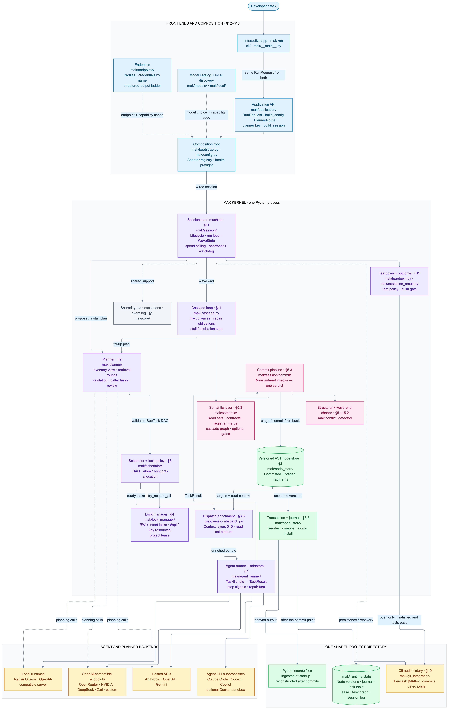
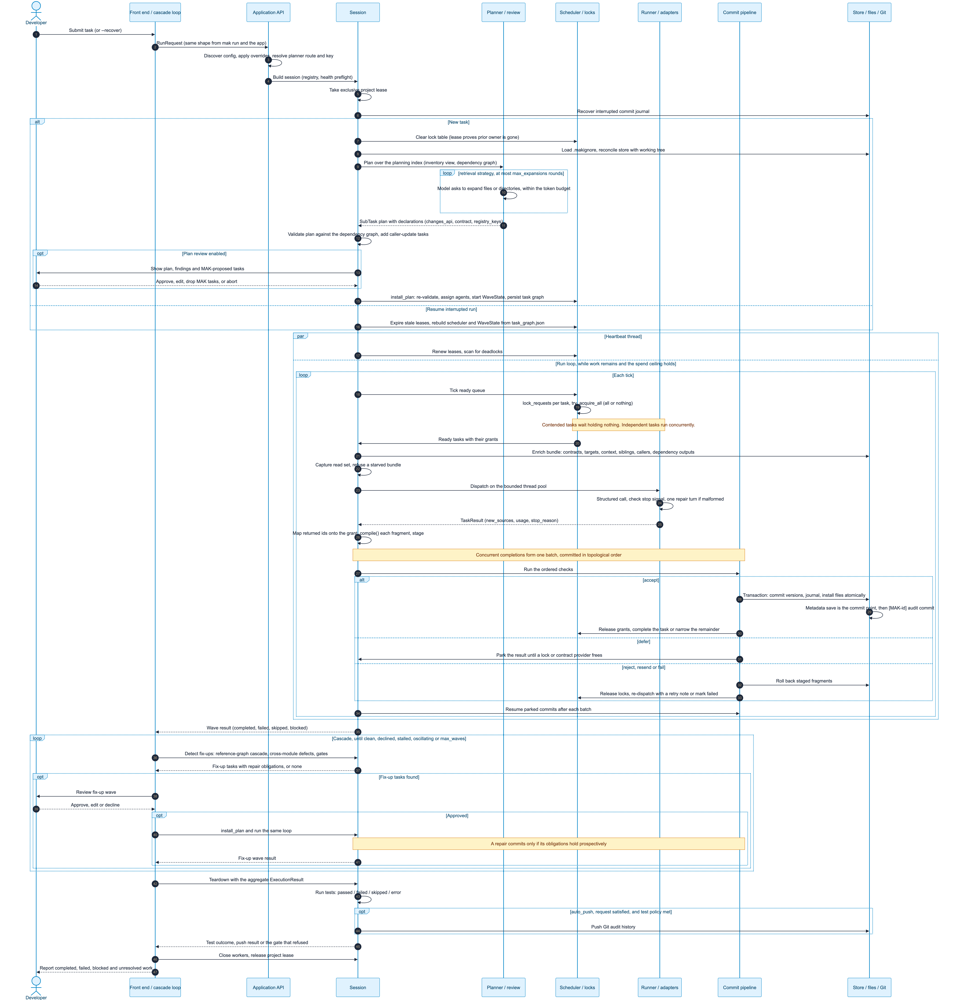
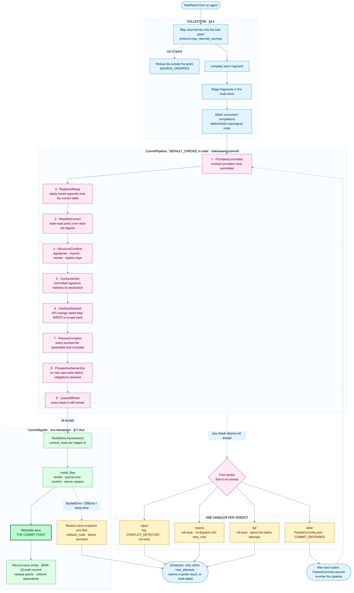

# Project diagrams

Three views of the implemented MAK runtime. The `.mmd` files are editable Mermaid
sources. The `.png` files are rendered exports using `mermaid_config.json`. Labels
cite the subsystem references (`§N`) indexed in
[CONTRIBUTING.md](../CONTRIBUTING.md#subsystems).

| Diagram | Mermaid source | PNG | Read with |
|---|---|---|---|
| Component architecture | [architecture.mmd](architecture.mmd) | [architecture.png](architecture.png) | [Overview](../docs/overview.md) |
| Execution sequence | [execution_sequence.mmd](execution_sequence.mmd) | [execution_sequence.png](execution_sequence.png) | [§11 Session lifecycle](../docs/subsystems/11-session-lifecycle.md) |
| Commit pipeline | [commit_pipeline.mmd](commit_pipeline.mmd) | [commit_pipeline.png](commit_pipeline.png) | [§5.3 Detection at commit](../docs/subsystems/05-conflict-detection.md#detection-at-commit) |

## Component architecture

Shows the two front ends converging on the application API and the composition
root, the kernel subsystems, the agent and planner backends (hosted,
OpenAI-compatible endpoints, local runtimes, CLI subprocesses), and the shared
project directory. Solid arrows indicate calls or data flow. Dotted arrows
indicate supporting relationships. Boxes group related modules rather than
separate services. Pink boxes are the conflict-detection layers that sit between
an agent's result and the node store. `tests/`, `benchmark/`, and `demo/`
exercise this runtime and are not runtime components.



## Execution sequence

Shows one run end to end:

1. Both front ends build the session through the application API.
2. The session takes the project lease, recovers the journal, and reconciles
   the store with the working tree.
3. The planner plans over a bounded inventory, expanding it in retrieval rounds.
4. The plan is validated, caller-update tasks are added, and the plan goes to
   review.
5. The run loop executes concurrently: atomic lock acquisition, enriched
   dispatch with read-set capture, the commit pipeline's verdicts, and parked
   commits.
6. Cascade waves follow, with their repair obligations and stop conditions.
7. Teardown runs the tests and applies the push gate.

Participants combine closely related components to keep the sequence readable.
Independent agent calls overlap, and commits are applied serially in
deterministic order. A partial result commits its completed grants and
re-dispatches only the remaining work.

Initial plan review is configurable. Cascade approval is supplied by the front
end, and the scripted CLI declines cascade waves under `--no-review`. A declined,
stalled or exhausted cascade remains part of the aggregate result. Git commits
and pushes are configurable, and a push requires a satisfied aggregate result
plus the test policy (`require_pass` by default; `allow_skip` also permits a
skipped suite).



## Commit pipeline

Zooms into the step between an agent's `TaskResult` and a durable commit.
Returned ids are mapped onto the lock grant and compiled. A batch then runs
through the nine `DEFAULT_CHECKS` in their pinned order, and the first verdict
that is not `accept` goes to its one handler. An accepted edit is committed by
`CommitApplier` in a single transaction whose commit point is the node store's
metadata save. Deferred results are parked and re-enter the pipeline after the
next batch.



## Regenerate the PNGs

From the repository root, with Node.js available (the exports were rendered with
Mermaid CLI 11.17.0, and the architecture uses its ELK layout):

```sh
for d in architecture execution_sequence commit_pipeline; do
  npx --package @mermaid-js/mermaid-cli@11.17.0 mmdc -i diagram/$d.mmd -o diagram/$d.png \
    -c diagram/mermaid_config.json -b white -w 2400 -s 2
done
```

If Puppeteer cannot find a browser, either install one with
`npx @puppeteer/browsers install chrome-headless-shell@<version>` (the error
message names the version), or add `-p /path/to/puppeteer-config.json`, a JSON
object whose `executablePath` points to Chrome. Rendering tools are documentation
tooling, not Python runtime dependencies.

The diagrams were checked against `mak/application/`, `mak/bootstrap.py`,
`mak/session/` (including `commit/pipeline.py`, `commit/apply.py` and
`parking.py`), `mak/scheduler/`, `mak/agent_runner/runner.py`,
`mak/node_store/transaction.py`, `mak/cascade.py`, `mak/teardown.py`, and the
CLI entry points.
